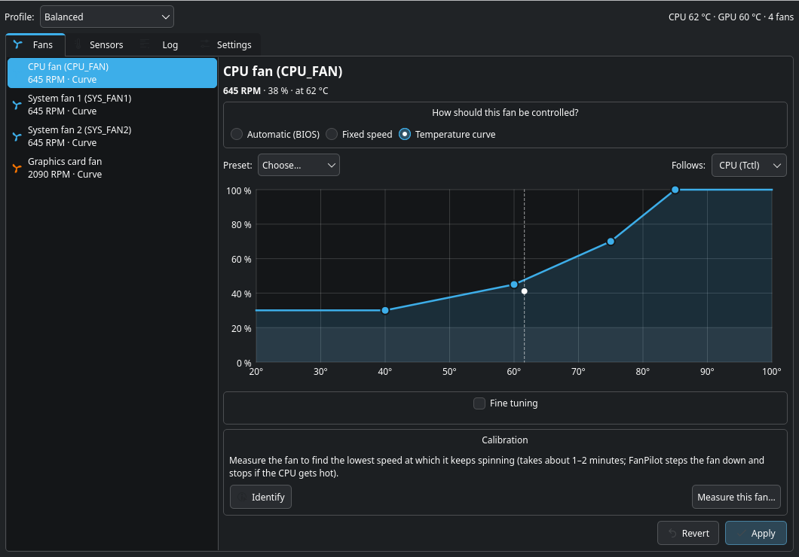
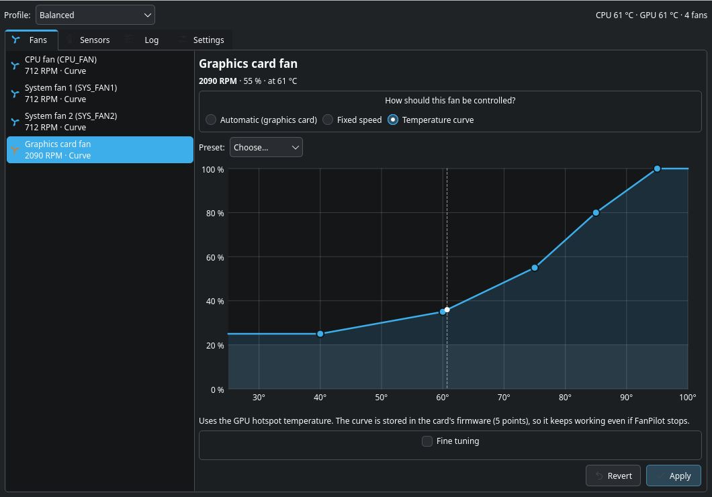
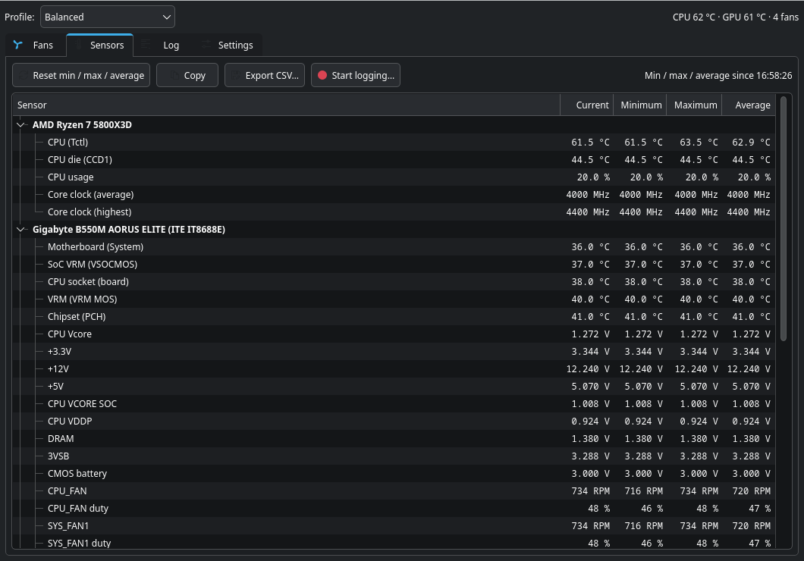
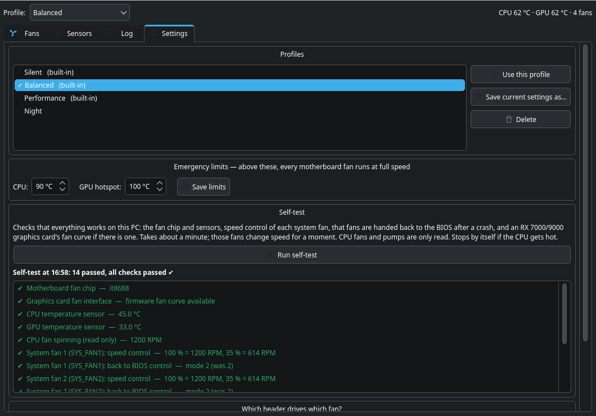
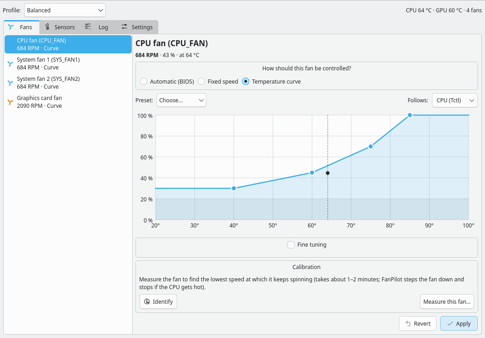
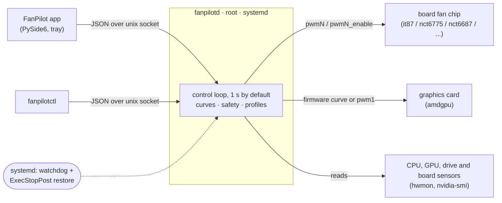

<div align="center">


# FanPilot

**Quiet, safe fan control for a Linux desktop: motherboard fans *and* the graphics card, in one simple app.**




</div>

---

## What it is

FanPilot is a fan controller for Linux desktops. A small root service (`fanpilotd`, Python standard library
only) drives the motherboard's fan headers through the kernel's hwmon drivers and the graphics card's fan
through its own interface, and an ordinary desktop app (PySide6, with a tray icon) lets you choose
*Automatic*, a *fixed speed* or a *temperature curve* for every fan. It names the headers the way the board
does where it knows the board, warns you when a fan stalls, and hands every fan back to the BIOS or the
card's firmware whenever it stops, crashes or is killed. A fresh install changes nothing: every fan starts on
*Automatic*.

## Screenshots

<table>
<tr>
<td></td>
<td></td>
</tr>
<tr>
<td align="center"><sub>Graphics card: 5-point curve stored in the card's firmware</sub></td>
<td align="center"><sub>Sensors: current, minimum, maximum and average, grouped by device</sub></td>
</tr>
<tr>
<td></td>
<td></td>
</tr>
<tr>
<td align="center"><sub>Profiles, emergency limits and the self-test</sub></td>
<td align="center"><sub>Follows your desktop theme, light or dark</sub></td>
</tr>
</table>

### Features

| | |
|---|---|
| **Three simple modes** | *Automatic* (BIOS or card decides), *Fixed speed*, or a *Temperature curve* |
| **Drag-and-drop curves** | Drag points, double-click to add, right-click to remove. A live marker shows where you are right now |
| **Follow any sensor** | e.g. case fans follow *the hotter of CPU and GPU*, so they also help while the GPU is busy |
| **Profiles** | Silent / Balanced / Performance built in, plus your own. One click in the app, the tray or the CLI |
| **GPU curve in firmware** | AMD RX 7000 / 9000: the card stores the curve itself, so it keeps working even if FanPilot is stopped. Zero-RPM optional |
| **Identify** | Runs one header slow for 3 s, then at full speed for 3 s, so you can see or hear which physical fan it is |
| **Measure (calibration)** | Finds each fan's stop/start speed and suggests a safe minimum |
| **Map my fans** | Finds which header drives which fan and hides headers with nothing connected |
| **Self-test** | *Settings → Run self-test* (or `fanpilotctl selftest`, about 45 s, no password): ✔/✖ for the chip, sensors, speed control, crash recovery and the GPU curve |
| **Stall warning** | A fan that stops while it should be spinning triggers a desktop notification while the app or its tray icon runs |
| **Sensors (HWiNFO-style)** | One table grouped by device: temperatures, voltages, clocks, power, load and fans, with Current / Minimum / Maximum / Average. Reset, copy, export to CSV or log every reading to a CSV file |
| **Your own alarms** | Right-click any sensor → *Alarm above… / below…*, or *Show on tray icon* to put its value in your panel |
| **Feels native** | Follows your desktop theme (light/dark), lives in the tray, and the window can be closed while control continues |
| **Sensor file for other programs** | `/run/fanpilot/sensors.tsv` (in RAM, rewritten once a second), e.g. for the [Logitech G510 keyboard LCD app](https://github.com/grumpybollocks/Logitech-G510s-LCD-control), which shows fan speeds and duty on the keyboard |

## Supported hardware

**Motherboard fans** are controlled through these kernel drivers (FanPilot writes only to chips on this list):

| Driver | Typical boards |
|---|---|
| ITE `it87` (in-tree, or the newer [frankcrawford/it87](https://github.com/frankcrawford/it87)) | most Gigabyte, some ASRock and older boards |
| Nuvoton `nct6775` family | most ASUS, many MSI and ASRock boards |
| Nuvoton `nct6687` ([nct6687d](https://github.com/Fred78290/nct6687d), out-of-tree) | newer MSI boards |
| Fintek `f71882fg` family | |
| Winbond `w83627ehf` family | |

Read-only (shown in the Sensors tab, never written to): `nct6683`, `asus-ec-sensors`, `asus_wmi_sensors`,
`gigabyte-wmi`, `hp-wmi-sensors` and any other chip not listed above.

Boards FanPilot knows (`fanpilot/boards.py`) get the headers' printed names (CPU_FAN, SYS_FAN1, ...). Any other
board works generically ("Fan 1", "Fan 2", ...), and every motherboard fan gets the CPU fan's protection until
you tell FanPilot which one the CPU fan is.

**Graphics cards**

| Card | What FanPilot does |
|---|---|
| AMD RX 7000 / 9000 with OverDrive | Temperature curve stored in the card's firmware (5 points), zero-RPM optional |
| AMD RX 7000 / 9000 without OverDrive | Shown read-only, with a hint: add the OverDrive bit (0x4000) to the `amdgpu.ppfeaturemask` kernel parameter |
| AMD up to RX 6000 | **Beta:** controlled like a motherboard header; handed back to the card on every exit |
| NVIDIA (proprietary driver) | Read-only temperature and fan % through `nvidia-smi`; it also counts for the GPU emergency limit |
| NVIDIA nouveau, Intel | Read-only, as far as the kernel reports anything |

**Laptops** (Dell, ThinkPad, ...) are read-only; use thinkfan or nbfc-linux for their fans.

## Install

Needs Linux with systemd and Python 3.10 or newer; the app also needs PySide6.

**Packages** (*after the first public release*, from the GitHub releases page):

| Distribution | How |
|---|---|
| Arch, Manjaro, EndeavourOS | AUR package `fanpilot` (e.g. `yay -S fanpilot`), app: `sudo pacman -S pyside6` |
| Debian 13+, Ubuntu 24.10+ | `sudo apt install ./fanpilot_<version>_all.deb` |
| Fedora 43+ | `sudo dnf install ./fanpilot-<version>-1.noarch.rpm` |

After a package install: `sudo usermod -aG fanpilot $USER` (log out and in), then
`sudo systemctl enable --now fanpilotd`.

**From source** (any distribution):

```bash
git clone https://github.com/grumpybollocks/fanpilot.git && cd fanpilot
sudo ./install.sh --autostart      # app + service (+ tray icon at login); runs the test suite first
```

Add `--gui-venv` on distributions without a PySide6 package (Ubuntu 24.04, Debian 12): it downloads PySide6
into `/opt/fanpilot/venv`. Don't mix a package and the source installer.

**Boards with an ITE chip** (most Gigabyte, some ASRock) usually need the `it87` driver set up:

```bash
sudo scripts/install-driver.sh          # from a package: sudo fanpilot-install-driver
scripts/install-driver.sh --dry-run     # see every step first, nothing is changed
```

Boards with a Nuvoton chip normally work out of the box. The graphics card needs no driver helper.

Full guide, per-distribution notes and the driver helper's details: **[docs/SETUP.md](docs/SETUP.md)**.

## First run

1. Open **FanPilot** from the app menu and check that the *Sensors* tab shows sensible values.
2. Optional: **Settings → Run self-test** (or `fanpilotctl selftest`, about 45 s).
3. Select each system fan and click **Identify** to see which physical fan is on which header. On a board
   FanPilot doesn't know, right-click the CPU fan → *This is a CPU fan*.
4. **Measure this fan…** for each system fan (PC idle), then *Use as lowest speed*.
5. Pick **Silent**, **Balanced** or **Performance** in the *Profile* box, or give a fan its own curve.

### Command line

`fanpilotctl` has these subcommands (`fanpilotctl <command> --help` for details):

```bash
fanpilotctl status                      # fans and temperatures
fanpilotctl sensors [-w]                # every reading, grouped like the Sensors tab (-w: refresh every second)
fanpilotctl config > my-fans.json       # print the current config as JSON (backup)
fanpilotctl set <fan> auto|fixed|curve [value]   # e.g. fixed 45, or curve 40:30,60:45,80:100
fanpilotctl calibrate [<fan>] [--stop]  # measure a motherboard fan's stop/start speed
fanpilotctl events                      # recent events
fanpilotctl map [--stop] [--forget]     # find which header drives which fan (about 15 s per header)
fanpilotctl report                      # anonymised hardware report (JSON) for bug reports; no root needed
fanpilotctl rename <id> [name]          # your own name for a fan or sensor (empty = default)
fanpilotctl cpu-fan [<fan>...]          # mark which motherboard fans are CPU fans (none = show them)
fanpilotctl identify <fan>              # slow for 3 s, then full speed for 3 s
fanpilotctl profile list|apply|save|delete [name]
fanpilotctl selftest                    # fans, crash recovery and GPU control (about 45 s)
fanpilotctl import my-fans.json         # load settings saved by 'config'
```

`fanpilotctl status` shows the fan ids (e.g. `nct6798/pwm2`, `it8688/pwm2`, `amdgpu/fan1`).

## Safety

FanPilot treats "a fan stopped when it shouldn't have" as the worst possible bug.

| Situation | What happens |
|---|---|
| The service stops, crashes, hangs or is killed | every fan goes back to BIOS / GPU-firmware control (systemd `ExecStopPost` + watchdog), and systemd restarts the service |
| A fan's temperature sensor fails 3 readings in a row (3 s at the default 1 s interval) | that fan goes to 100 % |
| CPU ≥ 90 °C or GPU hotspot ≥ 100 °C (adjustable) | all motherboard fans go to 100 %, including fans on Automatic |
| The CPU temperature fails 3 readings in a row | all motherboard fans go to 100 % until it reads again (an unreadable sensor never ends emergency mode) |
| The fan driver is reloaded or a sensor appears late at boot | FanPilot finds it again within 10 s |
| Another tool (e.g. LACT, CoreCtrl) resets the GPU curve | FanPilot re-applies it within 30 s (up to 3 times an hour) and names the tool in the log |
| FanPilot is updated while its window or tray icon is open | the app restarts itself as the new version (fan control is never interrupted) |
| CPU fan | never below 20 %, never stopped |
| Other fans | never below 10 % unless you allow them to stop |
| A fan stops spinning while being driven | desktop warning while the app or tray runs (the CPU fan's says *check it now*) |
| The BIOS keeps taking a fan back | after 5 times in a minute FanPilot leaves that fan on Automatic and tells you |
| The GPU firmware rejects a curve | retried after 60 s; after 3 failures the card keeps control |
| Invalid settings | rejected; the old settings stay in force |
| Fresh install | every fan starts on **Automatic**, so nothing changes until you choose |

### Verified on the reference machine

The reference machine is a Gigabyte B550M AORUS ELITE (ITE IT8688E fan chip) with an AMD Radeon RX 9060 XT.
The current version is 1.0.0 (the same code as 0.7.4); each result below lists the version it was measured with.
The self-test repeats the core checks on any PC.

| Check | Version | Result |
|---|---|---|
| Self-test, 14 checks | 0.7.4 | 14 passed: fan chip, sensors, both system fans 100 % → 35 % (1178 → 556 RPM, 1104 → 379 RPM), handed back to the BIOS in their original mode, crash recovery, GPU curve written and read back, GPU fan 1905 RPM at 40 %, handed back to the card |
| Fan chip | ≤ 0.2.2 | IT8688E; the kernel's built-in driver can't handle it, the DKMS `it87` driver built on kernel 7.2.9 |
| SYS_FAN1 manual control | ≤ 0.2.2 | 70 % → 964 RPM · 40 % → 632 RPM · 25 % → 391 RPM · back to BIOS → 1157 RPM |
| GPU fixed 35 % | ≤ 0.2.2 | 1568 RPM, zero-RPM off; firmware curve reads back exactly as written; no OverDrive errors in the kernel log |
| Driver quirk found | 0.2.0 | it87 reports a manual fan at 100 % as "full speed" (mode 0); FanPilot knows this is still its own setting |
| `sudo scripts/selftest.sh` (real `kill -9` crash test) | 0.2.1 | **12 / 12 passed**: speed control, hand-back to BIOS, fan back to BIOS after SIGKILL, service restarted by systemd, GPU curve |
| Profiles | 0.2.1 | BIOS ~1200-1300 RPM → **Silent** 665 / 434 / 492 RPM · **Performance** 1049 / 760 / 778 RPM |
| In-app self-test | 0.3.0 | **14 / 14 passed** |
| Sensors view | 0.4.0 | 39 readings, no false red values, every `pwm*_enable` unchanged |

### Also verified on

| Machine | Version | Result |
|---|---|---|
| ASUS TUF GAMING X570-PLUS (Nuvoton NCT6798, not in the board database), Ryzen 7 5700X3D, RX 9070 XT, kernel 7.2.9 | 1.0.0 | In-app self-test 7 / 7 passed; Map my fans: headers 1, 2, 3, 5 drive their own tachometers, 4, 6, 7 empty; every header back in its original BIOS mode afterwards (Smart Fan IV, header 7 full speed); GPU firmware curve applied (card range 30–100 %); found the three fixes listed under *Unreleased* in the changelog |

`sudo scripts/selftest.sh` (about 90 s) is a fuller version with a real SIGKILL crash test; it runs on the
reference board only and points to `fanpilotctl selftest` elsewhere.

## Uninstall

Stopping the service hands every fan back to the BIOS / card first, on every route.

```bash
sudo ./uninstall.sh                     # source install; add --purge to delete /etc/fanpilot too
sudo scripts/install-driver.sh --undo   # the it87 driver setup, if you used it

sudo fanpilot-install-driver --undo     # package install: undo the driver setup first, if you used it
sudo pacman -R fanpilot                 # (apt: sudo apt remove fanpilot / dnf: sudo dnf remove fanpilot)
```

## Troubleshooting

Missing motherboard fans, the "View only" banner, the BIOS taking fans back, GPU fan controls missing: see
**[docs/SETUP.md, Troubleshooting](docs/SETUP.md#troubleshooting)** and
**[My motherboard fans are missing](docs/SETUP.md#my-motherboard-fans-are-missing)**. FanPilot also shows
hints in the window, in `fanpilotctl status` and in the self-test.

## How it works



* The **service** uses only the Python standard library, so no third-party code runs as root.
  Changing settings is limited to allowed users (checked through the socket's peer credentials).
* The **app** is an ordinary user program. Close it and fan control carries on.
* Everything is tested against a **simulated sysfs tree** that also emulates the GPU firmware's
  stage/commit rules: **216 tests**, including real GUI widgets driven offscreen.

## Reporting bugs

Attach a hardware report: `fanpilotctl report > my-pc.json`. It is anonymised, needs no root, and becomes a
test machine for the fix. See [CONTRIBUTING.md](CONTRIBUTING.md) for adding a board and for code changes.

## Roadmap

See [docs/ROADMAP.md](docs/ROADMAP.md).

## Licence

FanPilot is licensed under the [GNU General Public License v3.0 or later](LICENSE) (GPL-3.0-or-later).

Credits: the `it87` driver is [frankcrawford/it87](https://github.com/frankcrawford/it87) (GPL-2.0, downloaded
by the driver helper, not bundled). The RDNA fan-curve rules follow the
[kernel docs](https://docs.kernel.org/gpu/amdgpu/thermal.html) and lessons from
[CoolerControl](https://gitlab.com/coolercontrol/coolercontrol). Calibration is inspired by
[fan2go](https://github.com/markusressel/fan2go).
